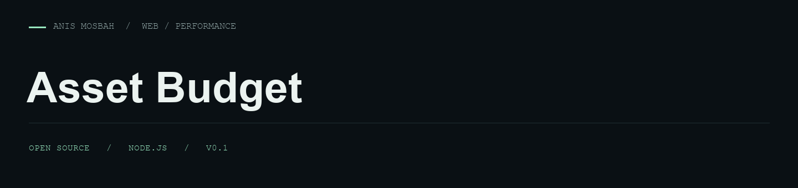
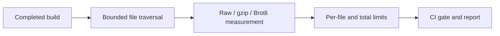

# Asset Budget

### Give every web build a measurable size budget.

**Node.js 22+** · **MIT** · **v0.1.0** · [API](index.mjs) · [Tests](project.test.mjs)

A dependency-free CLI and JavaScript API that measures built assets as **raw, gzip and Brotli bytes**, then enforces explicit limits in CI.

Use it when a new dependency quietly increases a release, a bundle grows beyond its intended budget, or a team needs a reproducible size report across build tools.

## What it delivers

| Capability | Behavior |
| :--- | :--- |
| Total budgets | Independent raw, gzip and Brotli byte limits. |
| Per-file budgets | Catch oversized individual chunks. |
| Extension filters | Include the assets relevant to your delivery. |
| Largest-file inventory | Identify the top ten contributors by raw size. |
| Bounded traversal | Explicit entry and file-size caps; symlinks are skipped. |
| CI-friendly output | Exit codes plus terminal, JSON, Markdown or HTML. |

## Run

```sh
git clone https://github.com/anistack72/asset-budget.git
cd asset-budget
node cli.mjs /path/to/your/dist --config budget.example.json
node cli.mjs /path/to/your/dist --config budget.example.json --format html > budget-report.html
```

Requires **Node.js 22+**. No runtime dependencies. Source distribution only; not yet published to npm.

## Configure integer byte limits

```json
{
  "total": { "raw": 1500000, "gzip": 500000, "brotli": 450000 },
  "perFile": { "raw": 500000 },
  "extensions": [".js", ".css", ".html"],
  "maxFiles": 5000,
  "maxFileBytes": 26214400
}
```

Unknown keys and invalid limits fail early. With no limits, the tool measures the build and reports a warning; an empty selection fails instead of silently passing.



## Use from JavaScript

```js
import { measureDirectory } from './index.mjs';
const report = await measureDirectory('./dist', { total: { gzip: 500000 } });
console.log(report.totals, report.largest);
```

## Measurement details

`schemaVersion: 1` includes every measured relative filename, all three sizes, aggregate totals, the largest files and skipped entries. gzip uses level 9; Brotli uses quality 6. Totals sum files compressed independently, which is closer to individually served assets than compressing an entire directory as one stream.

These figures are not network timings or Core Web Vitals. Server compression settings, caching, transfer overhead and route-level loading affect real delivery. Run against a completed, trusted build directory. A file detected as changing during measurement fails the run. The default maximum file size is 25 MiB; `maxFiles` bounds all visited directory entries, including folders.

Exit codes: **0** budgets passed, **1** a check failed, **2** invalid configuration or measurement error. `--strict` also fails on warnings. No network requests are made.

## Reproducible demonstration

Start with the [fixture-only walkthrough](docs/try-it.md): no production data or configured service is required. The same terminal, JSON and HTML demo paths are checked by `demo.test.mjs`.

```sh
node demo.mjs
node demo.mjs html > demo-report.html
```

The demo is explicitly labeled **synthetic**. It uses temporary local data or controlled fixture responses, never a third-party target. The generated HTML is standalone, with no remote scripts, fonts or analytics.

## Development

```sh
npm run check
npm test
```

Tests use local fixtures and local HTTP servers. The included CI matrix targets Node.js 22 and 24 on Linux, macOS and Windows. A local test pass does not mean that every CI platform has already run.

See [CONTRIBUTING.md](CONTRIBUTING.md) for changes and [SECURITY.md](SECURITY.md) for private security reports.

---

Built by **Anis Mosbah** · [Professional enquiries](mailto:contact@anis-mosbah.dev) · [MIT license](LICENSE)
